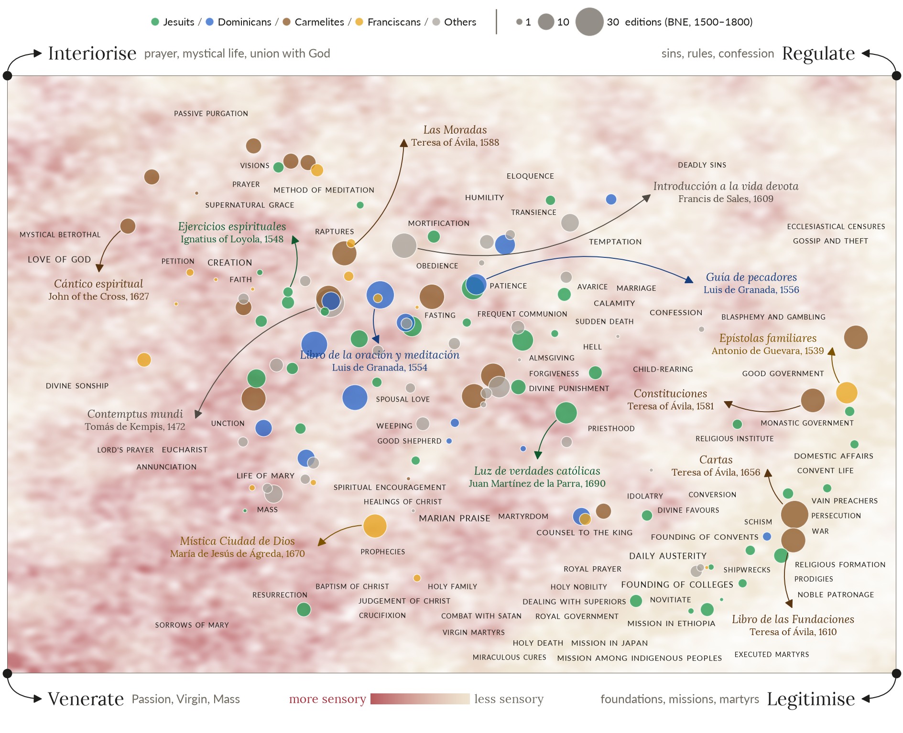

# Cartography of the corpus: what pastoral texts do

[Español](#español) · [English](#english)

## Español

Un juego exploratorio con el corpus: dividir los 151 textos en pasajes de 250 palabras, convertirlos en vectores con un modelo de lenguaje y buscar qué *hacen* los pasajes, más allá de lo que cuentan. No es un análisis definitivo: es una manera de recorrer el corpus y de hacerle preguntas.

**Qué muestra la figura.** Cada esquina es una función que aparece al agrupar los pasajes: *interiorizar* (oración, vida mística), *normar* (pecados, reglas, confesión), *venerar* (Pasión, Virgen, misa) y *legitimar* (fundaciones, misiones, mártires). Los temas (en versalitas) y las obras (las bolas de colores) quedan más cerca de las funciones que más cumplen sus pasajes. El color de la bola es la orden religiosa del autor; su tamaño, la cantidad de ediciones en español entre 1500 y 1800 en el catálogo de la Biblioteca Nacional de España. El fondo marca dónde se juntan los pasajes con más vocabulario de los sentidos. El plano está estirado para llenar el rectángulo: las posiciones son relativas.

### Los notebooks

Están en `notebooks/` y se corren en orden. Los dos primeros necesitan una GPU (Google Colab); los demás corren en cualquier computadora.

| Notebook | Qué hace |
| --- | --- |
| `01_embeddings.ipynb` | Divide los textos en pasajes de 250 palabras y los convierte en vectores con [BAAI/bge-m3](https://huggingface.co/BAAI/bge-m3) (Colab) |
| `02_map.ipynb` | Reduce los vectores con UMAP, agrupa los pasajes en temas con HDBSCAN y BERTopic, y dibuja los primeros mapas (Colab) |
| `03_functions.ipynb` | Quita de los vectores la dirección que indica si un pasaje narra o prescribe, y agrupa lo que queda en cuatro funciones (k-means) |
| `04_editions.ipynb` | Cuenta las ediciones de cada obra en el catálogo de la BNE (1500–1800) |
| `05_senses.ipynb` | Cuenta palabras de los cinco sentidos y estira el mapa para que llene el rectángulo |
| `06_figure.ipynb` | Dibuja la figura, en inglés o en español, en tres tamaños |

El método de `01` y `02` sigue a Alammar y Grootendorst, *Hands-On Large Language Models* (2024), cap. 5.

### Los datos

Cada notebook tiene arriba, en la primera celda, la carpeta de los datos (`DATA_DIR`). Por defecto es `data/results/`, dentro de esta carpeta; si guardás los datos en otro lado, cambiá esa línea.

- **En este repositorio**, en `data/results/`: los resultados livianos. Alcanzan para correr `06_figure.ipynb` sin calcular nada más.
- **En Zenodo** ([descargar](ENLACE-ZENODO)): los archivos grandes, que hacen falta para correr `03` y `05` o para rehacer el mapa. Guardalos en `data/results/`.

| Archivo | Dónde | Qué tiene |
| --- | --- | --- |
| `embeddings.npy` | Zenodo | Un vector de 1.024 dimensiones por pasaje (68.667 pasajes, `float16`) |
| `chunks_mapped.csv.gz` | Zenodo | Cada pasaje con su texto, su posición en el mapa UMAP y su tema |
| `umap_2d.npy`, `umap_5d.npy` | Zenodo | Las reducciones UMAP de `02` |
| `passages.csv.gz` | GitHub | Lo mismo que `chunks_mapped.csv.gz`, sin el texto |
| `themes.json` | GitHub | El nombre de cada uno de los 92 temas, en español (`es`) y en inglés (`en`) |
| `clusters.csv` | GitHub | Cada tema con sus palabras clave, su tamaño y la orden y el siglo que predominan |
| `texts.csv` | GitHub | Cada texto con su obra (`work_id`), su autor y su año |
| `functions_soft.csv.gz` | GitHub | El porcentaje de cada función en cada pasaje (`03`) |
| `editions.csv`, `editions_records.csv` | GitHub | Las ediciones de cada obra y cada registro de la BNE que se contó (`04`) |
| `senses.csv.gz`, `uniform_xy.csv.gz` | GitHub | Las palabras de cada sentido por pasaje y la posición de cada pasaje en el rectángulo (`05`) |

El catálogo de la BNE que usa `04` no está incluido.

### Límites

- Las cuatro funciones se separan muy poco: son gradientes, no cajas. Por eso cada pasaje tiene un porcentaje de cada una.
- Los nombres de los temas y de las funciones son una interpretación.
- Las ediciones son una aproximación: se cuentan por coincidencia de título y autor en un solo catálogo.

## English

An exploratory game with the corpus: split the 151 texts into passages of 250 words, turn them into vectors with a language model, and look for what the passages *do*, beyond what they tell. It is not a final analysis: it is a way to walk through the corpus and ask it questions.

**What the figure shows.** Each corner is a function that appears when the passages are grouped: *interiorise* (prayer, mystical life), *regulate* (sins, rules, confession), *venerate* (Passion, Virgin, Mass) and *legitimise* (foundations, missions, martyrs). Topics (in capitals) and works (the colored balls) sit closer to the functions their passages fulfil most. The color of a ball is the religious order of the author; its size, the number of editions in Spanish between 1500 and 1800 in the catalogue of the Biblioteca Nacional de España. The background marks where passages with more vocabulary of the senses gather. The plane is stretched to fill the rectangle: positions are relative.

### The notebooks

They are in `notebooks/` and run in order. The first two need a GPU (Google Colab); the others run on any computer.

| Notebook | What it does |
| --- | --- |
| `01_embeddings.ipynb` | Splits the texts into passages of 250 words and turns them into vectors with [BAAI/bge-m3](https://huggingface.co/BAAI/bge-m3) (Colab) |
| `02_map.ipynb` | Reduces the vectors with UMAP, groups the passages into topics with HDBSCAN and BERTopic, and draws the first maps (Colab) |
| `03_functions.ipynb` | Removes from the vectors the direction that tells whether a passage narrates or prescribes, and groups what remains into four functions (k-means) |
| `04_editions.ipynb` | Counts the editions of each work in the BNE catalogue (1500–1800) |
| `05_senses.ipynb` | Counts words of the five senses and stretches the map to fill the rectangle |
| `06_figure.ipynb` | Draws the figure, in English or Spanish, in three sizes |

The method of `01` and `02` follows Alammar and Grootendorst, *Hands-On Large Language Models* (2024), ch. 5.

### The data

Each notebook sets the data folder (`DATA_DIR`) in its first cell. By default it is `data/results/`, inside this folder; if you keep the data elsewhere, change that line.

- **In this repository**, in `data/results/`: the light results. They are enough to run `06_figure.ipynb` without computing anything else.
- **On Zenodo** ([download](ENLACE-ZENODO)): the large files, needed to run `03` and `05` or to redo the map. Save them in `data/results/`.

| File | Where | What it has |
| --- | --- | --- |
| `embeddings.npy` | Zenodo | One vector of 1,024 dimensions per passage (68,667 passages, `float16`) |
| `chunks_mapped.csv.gz` | Zenodo | Each passage with its text, its position on the UMAP map and its topic |
| `umap_2d.npy`, `umap_5d.npy` | Zenodo | The UMAP reductions of `02` |
| `passages.csv.gz` | GitHub | The same as `chunks_mapped.csv.gz`, without the text |
| `themes.json` | GitHub | The name of each of the 92 topics, in Spanish (`es`) and English (`en`) |
| `clusters.csv` | GitHub | Each topic with its keywords, its size and its main order and century |
| `texts.csv` | GitHub | Each text with its work (`work_id`), its author and its year |
| `functions_soft.csv.gz` | GitHub | The percentage of each function in each passage (`03`) |
| `editions.csv`, `editions_records.csv` | GitHub | The editions of each work and every BNE record counted (`04`) |
| `senses.csv.gz`, `uniform_xy.csv.gz` | GitHub | The words of each sense per passage and the position of each passage on the rectangle (`05`) |

The BNE catalogue used by `04` is not included.

### Limits

- The four functions separate very little: they are gradients, not boxes. That is why each passage has a percentage of each.
- The names of the topics and of the functions are an interpretation.
- Editions are an approximation: they are counted by matching title and author in a single catalogue.
